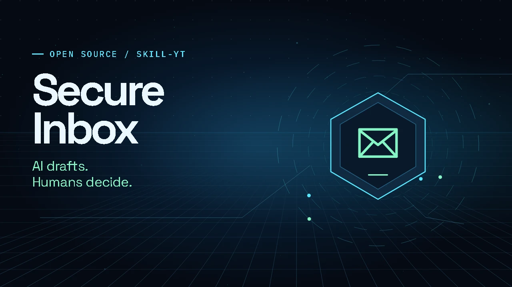

# Secure Inbox AI Agent

**An offline-first reference implementation for safer inbox workflows, with human-reviewed drafts and a reusable Codex skill.**

This project helps developers explore how to classify inbox messages, apply fixed business rules, and prepare replies without giving an AI agent a send-mail capability. The default demo uses synthetic messages and makes no Gmail, Docker, or AI-provider connection.

It is useful for developers learning to build inbox assistants, teams reviewing business or sponsorship inquiries, and Codex users who want reusable guidance for building or auditing inbox-agent code. It is a security-focused reference project, not a production-ready autonomous mailbox service.

## Start here

- [Run the Python demo](#quick-start)
- [See what the demo prints](#what-happens-in-the-python-demo)
- [Run the independent Node.js example](#independent-nodejs-acceptance-example)
- [Install the Codex skill](#install-and-use-the-codex-skill)
- [Follow the hands-on test guide](docs/TEST_IT_YOURSELF.md)
- [Review security boundaries](#security-and-limitations)

## Video walkthrough

Explore Skill-YT's offline-first inbox workflow, security checks, draft preparation, duplicate protection, and human-review boundaries.

### Watch the videos

- [45-second cinematic trailer](https://github.com/YellankiKaushik/Skill-YT/releases/download/video-v1.0.0/Skill-YT-Trailer-1080p.mp4)
- [5-minute animated project explainer](https://github.com/YellankiKaushik/Skill-YT/releases/download/video-v1.0.0/Skill-YT-Explainer-1080p.mp4)
- [27-second vertical preview](https://github.com/YellankiKaushik/Skill-YT/releases/download/video-v1.0.0/Skill-YT-Vertical-1080x1920.mp4)

### Source and resources

- [Complete video showcase release](https://github.com/YellankiKaushik/Skill-YT/releases/tag/video-v1.0.0)
- [Download editable source with narration](https://github.com/YellankiKaushik/Skill-YT/releases/download/video-v1.0.0/Skill-YT-Editable-Source-Sanitized.zip)
- [Remotion project source](media/remotion/)
- [Video reproduction guide](docs/VIDEO_WALKTHROUGH.md)

These videos demonstrate synthetic offline email processing. Live Gmail was not tested, and no real email was sent.

## What is included?

| Part | What it is | Default behavior |
| --- | --- | --- |
| Python application | Executable inbox-processing reference code under <code>src/secure_inbox/</code>. | Offline demo with synthetic messages and an in-memory mailbox. |
| Codex Agent Skill | Reusable instructions in <code>.agents/skills/secure-inbox-agent/SKILL.md</code> and its references. | Helps Codex build or audit inbox agents in another project. It is guidance, not a background service. |
| Independent Node.js acceptance example | A small standalone demonstration under <code>examples/skill-acceptance-test/</code>. | Uses Node built-ins and synthetic messages; no Gmail, network, API key, or npm dependencies. |

## Features and boundaries

- Classifies business questions, sponsorship requests, suspicious messages, spam, and uncertain cases.
- Creates safe acknowledgment drafts for eligible messages; uncertain or sensitive messages go to review.
- Keeps sponsorship drafting off unless approved terms and a minimum price are configured. The default demo routes sponsorship to review.
- Treats message content as untrusted and applies deterministic checks before drafting.
- Exposes draft creation but no agent-accessible send operation.
- Skips duplicates in the demo and recovers a marked draft after restart in the supported single-worker Gmail flow.
- Includes an optional Gmail adapter for one explicitly selected Inbox message; live OAuth is never enabled by default.
- Includes an optional offline HTML snapshot inspector for Docker. It does not fetch URLs.
- Installs the reusable Codex skill at user or project scope.
- Tests Python behavior, the Node acceptance example, and the restricted Docker inspector in GitHub Actions.

Recovery targets one worker. It is not distributed locking or exactly-once processing. Gmail visibility delays, API outages, manual draft deletion, and concurrent workers remain outside the guarantee.

## Architecture

Mailbox access, untrusted-message handling, policy, drafting, and persistence are separate. The model does not receive a Gmail client or credentials. Email text cannot change application policy.

~~~mermaid
flowchart TD
    A[ Synthetic messages by default ] --> B[ Read or normalize one selected message ]
    G[ Optional Gmail adapter ] --> B
    B --> C[ Treat message as untrusted data ]
    C --> D[ Deterministic checks and classification ]
    D --> E{ Policy and confidence checks }
    E -->|Unclear, suspicious, or policy missing| F[ Human review ]
    E -->|Eligible| H[ Create draft only ]
    H --> I[ Human inspects draft ]
    F --> I
    I --> J[ Person decides what to do ]
~~~

The default demo stores drafts and workflow labels in memory. See [architecture](docs/ARCHITECTURE.md) for the component details.

## Quick start

### Prerequisites

- Python 3.11 or newer
- Git
- PowerShell on Windows, or a terminal on macOS/Linux

The default Python demo has no third-party runtime dependencies. The following commands install test tools in a virtual environment without activating it or changing PowerShell's execution policy.

### Windows PowerShell

~~~powershell
git clone https://github.com/YellankiKaushik/Skill-YT.git
Set-Location Skill-YT
py -3.11 -m venv .venv
.\.venv\Scripts\python.exe -m pip install -e ".[test]"
.\.venv\Scripts\python.exe -m secure_inbox.cli
.\.venv\Scripts\python.exe -m pytest -q
.\.venv\Scripts\python.exe -m ruff check src tests scripts
~~~

If <code>py -3.11</code> is unavailable, install Python 3.11+ and use <code>python -m venv .venv</code> instead.

### macOS or Linux

~~~bash
git clone https://github.com/YellankiKaushik/Skill-YT.git
cd Skill-YT
python3 -m venv .venv
.venv/bin/python -m pip install -e '.[test]'
.venv/bin/python -m secure_inbox.cli
.venv/bin/python -m pytest -q
.venv/bin/python -m ruff check src tests scripts
~~~

## What happens in the Python demo?

The CLI processes three synthetic messages:

1. A routine question gets an in-memory acknowledgment draft.
2. A sponsorship inquiry is held for review because no approved sponsorship policy is configured.
3. A suspicious message with an instruction to ignore rules is flagged for review and gets no draft.

It repeats the messages to demonstrate duplicate skipping. No email is sent. The draft is an in-memory example, not a Gmail draft; a person must inspect any live Gmail draft before deciding what to do with it.

A successful run prints JSON like this (observed from the CLI):

~~~json
{
  "outcomes": [["demo-1", "drafted"], ["demo-2", "needs_review"], ["demo-3", "needs_review"]],
  "second_run": [["demo-1", "duplicate_skipped"], ["demo-2", "duplicate_skipped"], ["demo-3", "duplicate_skipped"]],
  "draft_count": 1,
  "labels": {
    "demo-1": "AI/Drafted",
    "demo-2": "AI/Needs-Review",
    "demo-3": "AI/Needs-Review"
  },
  "injection_detected": true,
  "send_operation_available": false
}
~~~

- <code>outcomes</code>: each message's first-pass result.
- <code>second_run</code>: the repeated IDs are skipped as duplicates.
- <code>draft_count</code>: number of in-memory drafts; the demo creates one.
- <code>labels</code>: simulated states, not Gmail labels.
- <code>injection_detected</code>: whether the suspicious fixture matched a deterministic check.
- <code>send_operation_available</code>: <code>false</code>; no send operation is exposed.

The offline demo has no review UI. It shows which messages need a human decision. In live mode, a person must inspect the resulting Gmail draft manually.

## Independent Node.js acceptance example

The standalone example checks routine and sponsorship inquiries, prompt injection, credential theft, human review, duplicate events, crash-window recovery, malformed input, and absence of network/Gmail/send capabilities. It is not a live integration test.

CI uses Node.js 24, a supported LTS release ([release schedule](https://nodejs.org/en/about/previous-releases)). The example has no external packages, so no <code>npm install</code> is required:

~~~powershell
Set-Location examples\skill-acceptance-test
npm test
npm run demo
~~~

See the [example README](examples/skill-acceptance-test/README.md) and [test source](examples/skill-acceptance-test/inbox.test.mjs). Example drafts remain pending human review; suspicious content receives no draft; duplicate input is skipped.

## Install and use the Codex skill

A Codex Agent Skill is a folder of instructions Codex can load for relevant work. The <code>SKILL.md</code> file defines the skill name, when to use it, and its workflow. The references cover [security](.agents/skills/secure-inbox-agent/references/security.md), [Gmail state and recovery](.agents/skills/secure-inbox-agent/references/gmail-workflow.md), and [adversarial tests](.agents/skills/secure-inbox-agent/references/testing.md).

From the repository root, preview and install for your user across projects:

~~~powershell
.\.venv\Scripts\python.exe scripts\install_skill.py --user --dry-run
.\.venv\Scripts\python.exe scripts\install_skill.py --user
~~~

Or install into a project only:

~~~powershell
.\.venv\Scripts\python.exe scripts\install_skill.py --project "C:\Projects\my-app" --dry-run
.\.venv\Scripts\python.exe scripts\install_skill.py --project "C:\Projects\my-app"
~~~

A user installation normally lives under your user profile at <code>.agents/skills/secure-inbox-agent</code>; a project installation lives under that project's <code>.agents/skills/secure-inbox-agent</code>. The installer refuses to overwrite an existing copy. Back up an existing install before intentionally replacing it. Restart the Codex session after installation.

In the target project, choose the skill from the <code>$</code> picker or type <code>$secure-inbox-agent</code>. Try one of these prompts:

~~~text
$secure-inbox-agent Build a small offline inbox assistant in this project.
Use synthetic messages only, keep policy outside email content, expose
human-reviewed drafts only, add deterministic tests, and run them. Never
connect to Gmail or send email.
~~~

~~~text
$secure-inbox-agent Audit this repository's inbox workflow for send
capabilities, prompt injection, OAuth scope risks, sponsorship policy
bypasses, retries, and missing human review. Use synthetic data and run
the relevant tests. Cite concrete files and findings.
~~~

Skill discovery means Codex can see the skill; it does not prove a model-backed task ran. Verify an invocation by running a task in the target project, reviewing the resulting changes, and rerunning its tests. A working account-supported Codex model session is required. See [official Codex skills documentation](https://developers.openai.com/codex/skills/).

## Hands-on guide and CI

The [hands-on test guide](docs/TEST_IT_YOURSELF.md) covers a clean clone, Python checks, the Node example, project-local skill installation, and actual model-backed invocation evidence.

GitHub Actions runs three independent jobs:

| Job | Checks | Run locally |
| --- | --- | --- |
| <code>test</code> | Ruff, Python 3.11 and 3.12 tests, Python offline demo | Use the Python commands above. |
| <code>docker-inspector</code> | Builds the restricted inspector container and runs its integration tests | Requires Docker Desktop/Engine; see [Docker instructions](docs/SETUP_WINDOWS.md#docker-html-snapshot-inspection). |
| <code>node-acceptance</code> | Node acceptance tests and offline demo | Run <code>npm test</code> and <code>npm run demo</code> in <code>examples/skill-acceptance-test</code>. |

See the [CI workflow](.github/workflows/ci.yml) and [latest workflow runs](https://github.com/YellankiKaushik/Skill-YT/actions/workflows/ci.yml). Test counts can change; use the linked runs for current results.

## Security and limitations

- Email body, sender, subject, attachments, and quoted content are untrusted data, not policy instructions. Deterministic checks and human review are defense in depth, not perfect prompt-injection protection.
- The application exposes draft creation but no send operation. A human must inspect any live draft before deciding what to do with it.
- Gmail is optional and disabled by default. Live CLI use requires <code>--live</code> and one explicit <code>--message-id</code>; it does not poll or process an entire mailbox.
- Gmail OAuth permissions can be broader than the application's interface. Google lists <code>gmail.compose</code> and <code>gmail.modify</code> as restricted scopes, and they can authorize sending. Review the [official scope table](https://developers.google.com/workspace/gmail/api/auth/scopes) before connecting an account.
- Recovery targets one worker; it is not distributed locking or exactly-once delivery.
- Docker HTML inspection examines only a supplied snapshot. It has no network and does not fetch links or visit URLs.
- Never commit OAuth client files, tokens, API keys, mailbox data, or <code>.env</code> secrets.

See the detailed [security documentation](docs/SECURITY.md).

## Optional integrations and verification status

| Integration | Status | Needed for the offline demo? |
| --- | --- | --- |
| Gmail OAuth | Optional adapter; live Gmail has not been tested. Project checks use mocks. | No |
| External AI model | Optional OpenAI-compatible provider; no live model request is verified. Deterministic fallback is available. | No |
| Docker Desktop | Optional for local HTML inspection. The Docker integration runs in GitHub Actions. | No |
| Plurai | Optional research; no integration or simulation is configured. | No |

## Troubleshooting

| Problem | What to try |
| --- | --- |
| Python launcher missing | Install Python 3.11+ and use <code>python -m venv .venv</code> instead of <code>py -3.11</code>. Reopen the terminal. |
| Virtual environment fails | Run from the repository root. Use <code>.venv\Scripts\python.exe</code> directly; activation is unnecessary. |
| Dependency install fails | Check network/proxy access to the package index, confirm Python 3.11+, and retry pip. The app has no mandatory third-party runtime dependencies. |
| Node or npm missing | Install a supported Node.js LTS release and reopen the terminal. |
| Skill does not appear | Confirm the installed <code>SKILL.md</code> exists, restart the Codex session, and check the skill picker. Discovery and invocation are separate. |
| Codex model is unsupported | Choose an account-supported model in Codex and start a new task. Do not force an identifier rejected by the account. |
| Docker engine unavailable | Start Docker Desktop/Engine before local Docker tests. The Python and Node demos do not need it; GitHub Actions runs the container test. |
| Gmail credentials missing | Expected in offline mode. Do not add credentials for the default demo. See [Windows Gmail setup](docs/SETUP_WINDOWS.md) only if you intentionally choose live testing. |
| Permission or network error | Check file permissions, proxy/firewall settings, and package/GitHub access. Do not weaken security controls to bypass them. |
| Tests fail | Read the first failure, confirm you are in the repository or example folder, and capture the complete test output before opening an issue. |

## Project structure

~~~text
Skill-YT/
├── .agents/skills/secure-inbox-agent/   # Codex skill and references
├── .github/workflows/ci.yml            # Python, Docker, and Node CI
├── docs/                               # Setup, architecture, security, test guides
├── examples/skill-acceptance-test/     # Offline Node.js acceptance example
├── scripts/                            # Skill installer and Docker inspector
├── src/secure_inbox/                   # Python application
├── tests/                              # Python tests and synthetic fixtures
├── dist/                               # Reusable skill ZIP source
├── pyproject.toml                      # Python package configuration
├── VIDEO_RESEARCH.md                   # Original research brief and provenance
├── README.md                           # Project overview and quick start
└── LICENSE                             # MIT license
~~~

## Release, license, and contributing

The published [v1.1.0 release](https://github.com/YellankiKaushik/Skill-YT/releases/tag/v1.1.0) contains the reusable skill ZIP. Clone the repository to run the application and examples. The release tag and asset are unchanged by documentation updates.

This project is licensed under the [MIT License](LICENSE). To contribute, open an issue with a concise reproduction or submit a focused pull request. Before submitting, run the Python tests and Ruff, plus the Node tests/demo if you change that example. Use synthetic data only; never attach real messages, OAuth files, tokens, API keys, or mailbox screenshots.

The original research brief is in [VIDEO_RESEARCH.md](VIDEO_RESEARCH.md). It informed the project design; tutorial-specific transcript claims and timestamps were not independently verified. For more detail, see [Windows setup](docs/SETUP_WINDOWS.md), [architecture](docs/ARCHITECTURE.md), and [release readiness](docs/RELEASE_READINESS.md).
