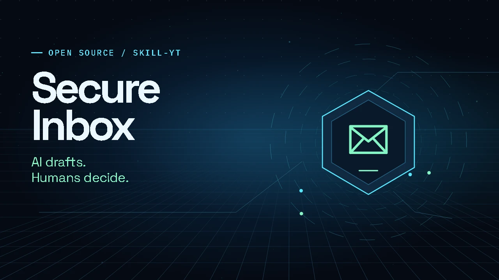

# Watch or render the Skill-YT walkthrough

The walkthrough follows synthetic email through classification and policy checks to a draft or a review queue. The separate Python and Node examples show their own observed results. The agent interface has no send operation.

| Cut | Runtime | Local export under `media/exports/` |
| --- | ---: | --- |
| Cinematic trailer | 0:45 | `Skill-YT-Trailer-1080p.mp4` |
| How Skill-YT Works | 5:00 | `Skill-YT-Explainer-1080p.mp4` |
| Portrait short | 0:27 | `Skill-YT-Vertical-1080x1920.mp4` |

Open the [Remotion project guide](../media/remotion/README.md) for preview and render commands. The [script and shot timings](../media/production/NARRATION.md), [caption files](../media/production/captions/), and [fact check](../media/production/FACT_CHECK.md) show how the production was assembled. Follow the [hands-on testing guide](TEST_IT_YOURSELF.md) to reproduce the project demos.

After generating the review package, open `media/exports/WATCH.html` for all three players, or open any MP4 in your desktop player. Exports include generated narration, original synthesized music and gate accents, and burned-in captions. The unchanged source renders remain in `media/remotion/out/`. Exports, audio assets, dependencies, caches, and temporary frames are excluded from Git.

The MP4s are local review masters. Public watch links can be added once the owner approves the cuts and verifies the upload URLs.
